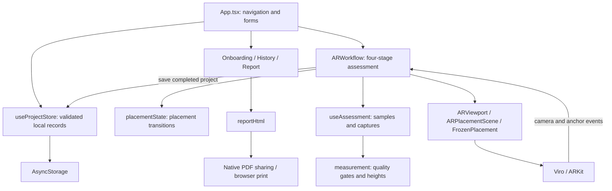

# PLCR technical handover

## Purpose and delivery status

PLCR is an iPhone app for visualising a fixed container footprint and recording relative ground heights at its support positions. The deliverable includes the React Native application, AR integration, local persistence, report export, automated tests and desktop launch scripts. The company can maintain it without a server deployment.

The project team confirms that the functional app was tested on an iPhone and works, including its implemented workflows. The team collected **35 test measurements**, and the company is already aware of those measurements. This is a handover statement from the team, not a new device test performed during documentation preparation. The raw measurement dataset, reference measurements and statistical analysis are not included in this repository, so this report does not assign an accuracy/error figure or claim a measured completion time.

The current UI is implemented and usable. Further visual changes depend on the company's forthcoming Figma/HTML designs. The previous lo-fi images have been removed; they are not the specification for the next UI revision.

## Supported environment and dependencies

| Layer | Repository version / role |
| --- | --- |
| Expo | `~57.0.27`; app configuration, bundling and native generation |
| React / React Native | `19.2.3` / `0.86.3` |
| TypeScript | `~6.0.3`; static checking |
| React Viro | `2.58.1`; ARKit scene, hit tests, tracking and camera transforms |
| AsyncStorage | `2.2.0`; local application records |
| Expo FileSystem / Print / Sharing | Local photos, PDF generation and iOS sharing |
| Safe Area Context / React Native SVG | Device layout and vector interface/report artwork |
| React Native Web / React DOM | Browser preview of non-AR screens |
| patch-package | Applies the committed Viro correction on `npm ci` |

Exact installed versions are controlled by `package-lock.json`; use `npm ci` for handover reproducibility. Node 22.13+ and iOS 16.4+ match the [SDK 57 requirements](https://docs.expo.dev/versions/v57.0.0/). The full app is supported on physical ARKit-capable iPhones only. The project targets a non-LiDAR iPhone 15 and does not depend on LiDAR. Browser preview is available on Windows, macOS and Linux. Android bundling exists in the export script but is not an accepted deployment target.

## Architecture

The app uses React state and a small explicit route model rather than a navigation framework or global state library. `App.tsx` owns route selection, dialogs, project selection and durable updates. AR state and capture state are scoped to the active assessment.



| Source | Responsibility |
| --- | --- |
| `index.ts` | Registers the root component with Expo. |
| `App.tsx` | Home, menus, profile/settings/project forms, simple routing and save/delete orchestration. |
| `src/screens/` | Onboarding, history/search/favourites, report view and AR workflow UI. |
| `src/screens/ARWorkflow.web.tsx` | Browser fallback explaining that AR requires an iPhone. |
| `src/ui/` | Shared buttons/sheets/headers, icons, artwork, themes, navigation translations and platform alerts. |
| `types.ts`, `placementState.ts` | Typed placement model/actions and pure reducer. |
| `placementGeometry.ts`, `PlacementControls.tsx` | Contact-plane geometry and placement controls. |
| `ARViewport.tsx` | Owns the stable native AR navigator with gravity alignment. |
| `ARPlacementScene.tsx` | Maps AR tracking, planes, hit tests and camera events into application callbacks. |
| `FrozenPlacement.tsx` | Renders the placed volume, footprint and numbered support markers. |
| `src/layout/layout.ts` | Shared dimensions, point numbering and report diagram geometry. |
| `src/assessment/` | Camera sample handling, capture quality, relative-height calculation and live feedback. |
| `src/projects/` | Data model/validation, queued persistence, report HTML and platform export adapters. |
| `tests/` | Node tests for placement, geometry, measurement and project/report behaviour. |
| `patches/` | Version-specific Viro patch applied after dependency installation. |
| `app.json`, `eas.json`, `run.sh`, `run.bat` | Native/build configuration and local setup helpers. |

## Placement and AR lifecycle

The four user stages are Scan ground, Position, Measure and Results. Internally, the placement reducer moves through `scanning`, `surface-selection`, `surface-locked` and `object-placed`, with a separate `assessmentLocked` flag preventing placement edits during measurement.

Automatic surface selection requires a horizontal plane at least 0.5 m in both reported dimensions, at least four observations in a three-second window, observations spanning at least 1.5 seconds, a newest observation no older than 1.5 seconds, and height range no greater than 2 cm. These thresholds establish a stable candidate; the user still decides whether it is actually the intended ground. Manual selection uses an AR hit test and also requires normal tracking.

Confirming the surface copies its selected world position and freezes `groundY`. Subsequent anchor refinements, anchor removal and discovery of furniture do not rewrite the stored placement. The footprint remains on that confirmed plane while the user translates or rotates it. Support points are derived from the fixed centre and yaw. Final lock rejects movement/rotation actions in the reducer, independently of disabled UI controls.

`ARViewport` remains mounted during ordinary rescanning/reset operations so the camera session and world origin survive. A logical reset clears placement and measurement state while retaining live camera/tracking/plane observations. The explicit Restart AR tracking action resets the native session and reducer together. Leaving AR and starting another session creates a fresh coordinate system; persisted coordinates must never be used to restore a live placement into that session.

App backgrounding marks tracking as limited. During measurement, non-normal tracking invalidates the sequence and requires restarting all captures to keep a consistent reference. Returning to editing clears captures as well.

## Layout and coordinate conventions

Internal world coordinates and geometry are in **metres**. Reports display distances/heights in **centimetres**. Y is vertical; X/Z form the ground plane. Yaw is expressed in degrees around Y. Viro uses gravity alignment rather than geographic positioning.

A single layout is 3 m wide (X) and 6 m deep (Z), with two long support lines at X = ±1.5 m. The dual layout is 6 × 6 m, with lines at X = −3, 0 and +3 m. Each line has positions at Z = −3, 0 and +3 m. Points are numbered end–midpoint–end along each line. In dual mode, P4–P6 belong to the shared seam and are captured once. The rendered container height is 2.5 m as a visual aid.

The layout is chosen when the draft is created and cannot change during assessment. `layout.ts` drives AR points, completion counts and report diagrams together. Records predating the layout field are interpreted as single-container projects.

## Measurement method

At each planned support, the operator holds the same phone upright in portrait with the centre of its bottom edge touching the ground. The camera stays uncovered. The app cannot sense physical contact; pressing capture is the operator's confirmation.

`contactQuality` evaluates the most recent continuous steady hold within a rolling three-second sample window. Capture requires all of the following:

| Gate | Value |
| --- | --- |
| Tracking | Normal |
| Latest valid camera reading | No older than 750 ms |
| Horizontal camera distance from target | ≤30 cm |
| Phone tilt from upright | ≤10° |
| Continuous steady duration | ≥2 seconds |
| Sample count | ≥3 |
| Gap between samples | ≤650 ms, timestamps strictly increasing |
| Movement spread | ≤1.5 cm on each world axis |

An invalid/out-of-range reading, sample discontinuity or excess movement restarts the qualifying hold. A successful capture stores the per-axis median camera position, timestamp, tilt and movement spread. Captures are sequential and duplicate point IDs are blocked.

For point i:

```text
relativeHeightCm(i) = 100 × (medianCameraY(i) − medianCameraY(1))
```

Using the same phone/case/contact posture makes the unknown camera-to-bottom vertical offset cancel approximately in this difference. P1 is therefore zero by definition. Camera X/Z are used as proxies for horizontal contact position; their camera-to-edge offset is not calibrated. The result keeps planned support position, measured camera position and estimated contact position as separate fields.

Estimated contact Y is the nominal support plane height plus the measured relative difference. It is not an independently measured absolute ground elevation. Capture spread describes short-window stability, not measurement error. AR drift, surface texture, lighting, device movement and contact posture can all affect the result.

The report summarises minimum, maximum and range across all six/nine relative heights. Colours use absolute relative height: green ≤2 cm, orange >2 to ≤5 cm, red >5 cm. These are display thresholds, not a validated site suitability classification. There is no terrain reconstruction, obstacle/clearance proof, GPS/AHN integration, calibrated surveying or installation approval.

## Persistence and data handling

`useProjectStore` serialises one versioned JSON document under AsyncStorage key `@plcr/app/v1`. It contains `version: 1`, projects, preferences (theme/language/onboarding) and an optional local profile (name/email/company). There is no backend, authentication, telemetry service or cross-device synchronisation implemented in the application.

A project contains its generated ID, layout, name, manually entered location/notes, timestamps, draft/completed status, favourite flag, optional placement/yaw/photo URI, raw captures and derived measurements. IDs are local identifiers, not authentication tokens. Draft creation is persisted before the AR screen opens. Active placement and partial captures remain in memory until completion; a continued draft starts a fresh scan and measurement sequence.

Writes are queued and awaited. React state only updates after storage succeeds, and callers display save errors. Startup calls `parseData` to validate schema, preferences, finite coordinates, IDs and completed-project measurement counts. Unsupported/corrupt data shows an error with Retry instead of being silently overwritten. There is no general schema migration framework; the missing-layout fallback is the current compatibility rule. Add explicit migration and tests before changing persisted schema.

AR screenshots are copied into the app document directory as project-specific JPEGs; the record stores their URI. Deleting a project first removes the saved record, then attempts to delete the photo. Photo cleanup failures are logged. Data is not encrypted by application code; operating-system storage/backup policies apply. Uninstalling or clearing browser storage can lose records. There is no project backup/import feature; exported PDFs cannot restore editable data.

## Reports and sharing

The screen report and exported report use the project's saved real measurements. `reportHtml` escapes user-entered metadata and generates the layout diagram, project/date/operator name/company, notes, point table, spread, estimated XYZ, summary and measurement limitations. The profile email and AR photo are not included in this HTML/PDF. Operator name/company are read from the current profile when exporting, rather than snapshotted at assessment time.

On iOS, Expo Print creates a temporary PDF, Expo Sharing opens the native share sheet, and FileSystem removes the temporary PDF afterward. The recipient/destination is chosen by the user. Cancelling the share sheet does not remove the saved project. On web, a platform-specific adapter opens a print window; pop-ups must be allowed.

## Native dependency patch

`patches/@reactvision+react-viro+2.58.1.patch` changes the plane selector's projected polygon Z coordinate to `-z` in both its source and distributed JavaScript. This corrects the XZ-to-XY projection used when drawing the plane polygon. `postinstall: patch-package` applies it on each locked install.

Do not remove the patch or blindly upgrade Viro. Check whether upstream incorporates the correction, re-evaluate projection behaviour on an iPhone, and regenerate/remove the version-specific patch as appropriate. The numbered ground markers use flat quad strokes; preserve their device-tested behaviour when changing rendering near the camera.

## Build, ownership and distribution

`app.json` defines portrait orientation, iPhone-only targeting (`supportsTablet: false`), camera permission text, Viro/sharing plugins and the public support URL. Photo-library and microphone permission descriptions are also present; their presence is not evidence that the app requests or uses all of those permissions. Application code explicitly requests camera permission for AR.

The personal bundle identifier and EAS project ID have been removed. The company must replace `com.example.plcr`, create/link its own EAS project and use its own Apple Developer account/signing team. The support page is configurable through `expo.extra.supportUrl`; an empty value gives a supervisor-contact message. None of those public identifiers is a credential.

`eas.json` currently defines only an internal `development` build for a physical iPhone. The scripts install/check the app and optionally run EAS login, initialisation, build configuration, device registration and build submission. EAS cloud builds can be requested from Windows, macOS and Linux. Local iPhone compilation requires macOS/Xcode. Native folders are generated and ignored by Git.

There is no production/TestFlight/App Store profile, store submission setup or EAS Update configuration supplied. JavaScript export is not an installable binary. A future release requires company-owned signing/distribution configuration and a suitable release build. The [README](README.md) is the operational setup guide.

The existing GitHub repository is the shared handover repository. A normal commit preserves its history; earlier source identifiers and Git author metadata remain visible in past commits. Current source/configuration no longer contains the personal bundle identifier, EAS project link or support URL. Commit `7156227` retains the original local development configuration and can be checked out separately using the worktree command in the README. Preserve upstream licensing notices.

## Verification and maintenance

`npm run typecheck` checks all TypeScript. `npm test` runs the Node test suite for plane selection/stability, immutable placement, geometry/rotation, reset behaviour, capture gates/median/reference math, project validation/persistence round trips and single/dual report generation. These tests exercise application logic; they do not boot ARKit or measure real-world error. `npm run export` checks JavaScript/assets bundling across the configured platforms.

The team's completed iPhone testing and 35 measurements establish the reported handover status. Repeat the physical-device checks in [TESTING.md](TESTING.md) after changes to AR, native dependencies, persistence or controls. Keep raw future measurement/reference datasets and device/build conditions with company test records so accuracy and repeatability can be assessed from evidence.

For forthcoming designs, start with `src/ui/theme.ts`, shared components and `src/screens/`, plus the forms/menus/styles in `App.tsx`. Some AR/report styling is local to those components; theme tokens do not control every colour. Navigation/control translations are in `src/ui/i18n.ts`; technical instructions and PDF content remain English. The PDF HTML has independent styles and will need separate design review.

Keep reducer lock guards, capture-quality gates, point ordering, layout completion counts and persistence validation intact when replacing presentation. JavaScript-only visual edits generally need no new native build. Native dependencies or app configuration changes require regeneration/rebuild. Use the lockfile, review dependency changes and any `npm audit` results together with SDK compatibility; no current advisory count is asserted in this report.
